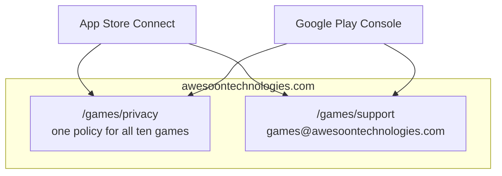

<!-- Generated by Blueprint Maker from businesses/simple-game-factory/repos/studio-website/architecture.md. Do not edit here: change the blueprint, then sync. -->

# Architecture

The games' part of the studio site is two static pages. The rest of the site is out of scope for this blueprint.

- Outside parties: Apple and Google load the privacy link at review.
- The site is a Next.js app; it also has a games index and one page per game (checked 2026-11-04). Assumption: the host is not yet recorded.
